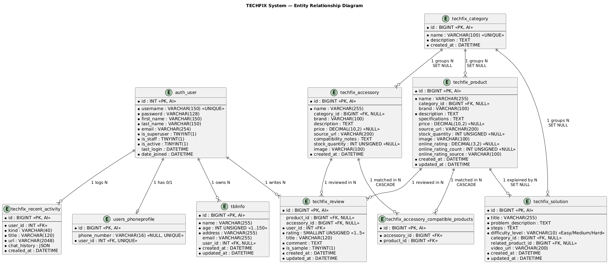
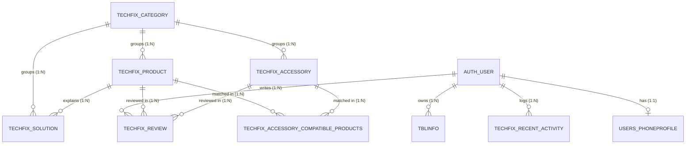

# TECHFIX System — Database & ERD

**Project:** `projectv3` (Django `apps.core` + `apps.info` + `apps.users`/auth)
**Source of truth:** `apps/core/models.py`, `apps/info/models.py`, `apps/users/models.py`, live `techfix_db` (MySQL/MariaDB)
**Generated:** 2026-11-11

## Files in this folder

| File | Purpose |
|---|---|
| `techfix_database.sql` | Schema for **MySQL / MariaDB** (`CREATE DATABASE techfix_db` + 26 tables: 17 Django framework + 9 app tables, with PK/FK/indexes/checks). Import with phpMyAdmin or `mysql < techfix_database.sql`. |
| `techfix_database_dump.sql` | Full dump of the live `techfix_db` for **MySQL / MariaDB** (schema + data + `django_migrations`). Restore with `mysql -u root techfix_db < techfix_database_dump.sql`. |
| `techfix_database_sqlite.sql` | Same schema for **SQLite**. Apply with `sqlite3 db.sqlite3 < techfix_database_sqlite.sql`. |
| `techfix_database_dump_sqlite.sql` | Data dump of the legacy `projectv3/db.sqlite3` (2026-11-10), kept as a backup. |
| `ERD.mmd` | Editable ERD source (Mermaid `erDiagram`). Paste into https://mermaid.live or any Mermaid viewer. |
| `ERD.puml` | Editable ERD source (PlantUML). Open with a PlantUML plugin or http://www.plantuml.com/plantuml/uml. |
| `ERD.svg` | Vector diagram (opens in any browser, scales for reports). |
| `ERD.png` | Raster diagram (for Word / PPT / PDF submissions). |
| `ERD.md` | This file — data dictionary + relationships. |

## ERD (preview)

> If the image does not preview in your editor, open `ERD.png` or `ERD.svg` directly.
> The editable definitions are `ERD.mmd` (Mermaid) and `ERD.puml` (PlantUML); the
> rendered images were regenerated from `ERD.puml` on 2026-11-11.

## Entities (data dictionary)

### 1. `auth_user` — Django default user (used by `apps.users`)
| Column | Type | Key | Notes |
|---|---|---|---|
| id | INT AI | PK | |
| username | VARCHAR(150) | UNIQUE | login name |
| password | VARCHAR(128) | | hashed |
| first_name / last_name | VARCHAR(150) | | |
| email | VARCHAR(254) | | |
| is_superuser / is_staff / is_active | TINYINT(1) | | superuser sees all `tblinfo`; others see own only (`apps/scoping.py`) |
| last_login | DATETIME NULL | | |
| date_joined | DATETIME | | |

### 2. `techfix_category` — grouping (ex. Laptops, Audio, Chargers)
| Column | Type | Key | Notes |
|---|---|---|---|
| id | BIGINT AI | PK | |
| name | VARCHAR(100) | UNIQUE | |
| description | TEXT | | |
| created_at | DATETIME | | auto_now_add |

### 3. `techfix_product` — main tech devices (laptop, phone, printer, router)
| Column | Type | Key | Notes |
|---|---|---|---|
| id | BIGINT AI | PK | |
| name | VARCHAR(255) | | |
| category_id | BIGINT NULL | FK → category.id | `SET NULL`, `related_name='products'` |
| brand | VARCHAR(100) | | |
| description | TEXT | | |
| specifications | TEXT | | RAM, CPU, Storage, etc. |
| price | DECIMAL(10,2) NULL | | optional (catalog items may have no price) |
| source_url | VARCHAR(200) | | reference/listing URL |
| stock_quantity | INT UNSIGNED NULL | | optional; DB CHECK >= 0 |
| image | VARCHAR(100) NULL | | `upload_to='products/'` |
| online_rating | DECIMAL(3,2) NULL | | aggregate rating from an online catalog |
| online_rating_count | INT UNSIGNED NULL | | number of online ratings |
| online_rating_source | VARCHAR(100) | | ex. Smartprix |
| created_at / updated_at | DATETIME | | |

### 4. `techfix_accessory` — add-ons (cases, chargers, keyboards, earbuds, cables)
| Column | Type | Key | Notes |
|---|---|---|---|
| id | BIGINT AI | PK | |
| name | VARCHAR(255) | | |
| category_id | BIGINT NULL | FK → category.id | `SET NULL`, `related_name='accessories'` |
| brand | VARCHAR(100) | | |
| description | TEXT | | |
| price | DECIMAL(10,2) NULL | | optional |
| source_url | VARCHAR(200) | | reference/listing URL |
| compatibility_notes | TEXT | | ex. Compatible with USB-C laptops |
| stock_quantity | INT UNSIGNED NULL | | optional; DB CHECK >= 0 |
| image | VARCHAR(100) NULL | | `upload_to='accessories/'` |
| created_at | DATETIME | | |

### 5. `techfix_accessory_compatible_products` — M:N junction (auto-created by Django)
`Accessory.compatible_products = ManyToManyField(Product, related_name='compatible_accessories')`
| Column | Type | Key | Notes |
|---|---|---|---|
| id | BIGINT AI | PK | |
| accessory_id | BIGINT | FK → accessory.id, `CASCADE` | part of `UNIQUE(accessory_id, product_id)` |
| product_id | BIGINT | FK → product.id, `CASCADE` | part of `UNIQUE(accessory_id, product_id)` |

### 6. `techfix_solution` — step-by-step fix for a common tech problem
| Column | Type | Key | Notes |
|---|---|---|---|
| id | BIGINT AI | PK | |
| title | VARCHAR(255) | | |
| problem_description | TEXT | | symptoms / common issue |
| steps | TEXT | | Step 1, Step 2, … |
| difficulty_level | VARCHAR(10) | | `Easy` / `Medium` / `Hard` (Django choices) |
| category_id | BIGINT NULL | FK → category.id | `SET NULL` |
| related_product_id | BIGINT NULL | FK → product.id | `SET NULL`, `related_name='solutions'` |
| video_url | VARCHAR(200) | | blank allowed |
| created_at / updated_at | DATETIME | | |

### 7. `techfix_review` — customer rating and feedback
| Column | Type | Key | Notes |
|---|---|---|---|
| id | BIGINT AI | PK | |
| product_id | BIGINT NULL | FK → product.id, `CASCADE` | one of product/accessory is required |
| accessory_id | BIGINT NULL | FK → accessory.id, `CASCADE` | one of product/accessory is required |
| user_id | INT | FK → auth_user.id, `CASCADE` | `related_name='reviews'` |
| rating | SMALLINT UNSIGNED | | 1–5 (`RATING_CHOICES`); DB CHECK >= 0 |
| title | VARCHAR(120) | | optional |
| comment | TEXT | | |
| is_sample | TINYINT(1) | | demo reviews imported for display |
| created_at / updated_at | DATETIME | | |

DB CHECK `techfix_review_exactly_one_item` enforces exactly one of product/accessory.
Unique user+product and user+accessory constraints exist as Django conditional
constraints; MariaDB 10.4 cannot enforce partial unique indexes, so those are
enforced by the application only.

### 8. `techfix_recent_activity` — dashboard activity log
| Column | Type | Key | Notes |
|---|---|---|---|
| id | BIGINT AI | PK | |
| user_id | INT | FK → auth_user.id, `CASCADE` | `related_name='recent_activities'` |
| kind | VARCHAR(40) | | ex. assistant, library |
| title | VARCHAR(120) | | |
| url | VARCHAR(2048) | | |
| chat_history | JSON | | list of chat messages (`JSONField`) |
| created_at | DATETIME | | |

### 9. `users_phoneprofile` — `apps.users.PhoneProfile`
| Column | Type | Key | Notes |
|---|---|---|---|
| id | BIGINT AI | PK | |
| phone_number | VARCHAR(16) NULL | UNIQUE | |
| user_id | INT | FK → auth_user.id, `CASCADE` | UNIQUE (1:1), `related_name='phone_profile'` |

### 10. `tblinfo` — `apps.info.Info` (name/age/address/email, privately owned)
| Column | Type | Key | Notes |
|---|---|---|---|
| id | BIGINT AI | PK | `db_table='tblinfo'`, ordering by name |
| name | VARCHAR(255) | | |
| age | INT UNSIGNED | | Django validators 1–150; DB CHECK >= 0 |
| address | VARCHAR(255) | | |
| email | VARCHAR(255) | | blank allowed |
| user_id | INT NULL | FK → auth_user.id | `CASCADE`, `related_name='infos'` |
| created_at / updated_at | DATETIME | | |

## Supporting Django tables (not domain entities)

The ERD above shows the domain/auth entities. The database also needs these
17 framework tables to run; all SQL scripts create them:

| Table | Purpose |
|---|---|
| `django_migrations` | Migration history used by `manage.py migrate` |
| `django_content_type` | Model/content-type registry |
| `django_site` | Sites framework (`SITE_ID = 1`, used by allauth) |
| `auth_permission` | Permission definitions |
| `auth_group` | User groups |
| `auth_group_permissions` | M:N group → permission |
| `auth_user_groups` | M:N user → group |
| `auth_user_user_permissions` | M:N user → permission |
| `django_admin_log` | Django admin change history |
| `django_session` | Login sessions |
| `account_emailaddress` | allauth e-mail addresses |
| `account_emailconfirmation` | allauth e-mail confirmations |
| `socialaccount_socialaccount` | allauth linked social logins (Google) |
| `socialaccount_socialapp` | allauth provider apps |
| `socialaccount_socialapp_sites` | M:N social app → site |
| `socialaccount_socialtoken` | allauth provider tokens |

`auth_user` is shown in the ERD because several tables reference it.

## Relationships (crow's foot: 1 ──∞)

| # | Parent (1) | Child (N) | FK | On delete | Meaning |
|---|---|---|---|---|---|
| R1 | `auth_user` | `tblinfo` | `tblinfo.user_id` | CASCADE | 1 user owns N info rows |
| R2 | `techfix_category` | `techfix_product` | `product.category_id` | SET NULL | 1 category groups N products |
| R3 | `techfix_category` | `techfix_accessory` | `accessory.category_id` | SET NULL | 1 category groups N accessories |
| R4 | `techfix_category` | `techfix_solution` | `solution.category_id` | SET NULL | 1 category groups N solutions |
| R5 | `techfix_product` | `techfix_solution` | `solution.related_product_id` | SET NULL | 1 product explained by N solutions |
| R6/R7 | `techfix_product` ↔ `techfix_accessory` | junction | `accessory_id`, `product_id` | CASCADE/CASCADE | M:N — accessory works with many products and vice versa |
| R8 | `techfix_product` | `techfix_review` | `review.product_id` | CASCADE | 1 product has N reviews |
| R9 | `techfix_accessory` | `techfix_review` | `review.accessory_id` | CASCADE | 1 accessory has N reviews |
| R10 | `auth_user` | `techfix_review` | `review.user_id` | CASCADE | 1 user writes N reviews |
| R11 | `auth_user` | `techfix_recent_activity` | `recent_activity.user_id` | CASCADE | 1 user has N activity entries |
| R12 | `auth_user` | `users_phoneprofile` | `phone_profile.user_id` | CASCADE | 1 user has 0/1 phone profile (UNIQUE) |

## How to use

**MySQL / phpMyAdmin (database `techfix_db`):**
1. Full restore (schema + data): create an empty `techfix_db`, then import
   `techfix_database_dump.sql` (phpMyAdmin → Import, or
   `mysql -u root techfix_db < SQL/techfix_database_dump.sql`). The dump already
   contains `django_migrations`, so no `migrate --fake` is required.
2. Schema only: import `techfix_database.sql` (it creates `techfix_db`), then run
   `python manage.py migrate --fake` once to record the migrations.
3. The project connects to `techfix_db` through `mysite/settings.py` (XAMPP
   defaults: `root` with an empty password on `127.0.0.1:3306`).

**SQLite:**
`sqlite3 db.sqlite3 < SQL/techfix_database_sqlite.sql`
then `python manage.py migrate --fake` once to record the migrations.
For a normal install, just run `python manage.py migrate` on an empty database —
Django creates the identical tables.

**ERD for documentation:**
- Word/PPT/PDF → insert `ERD.png`.
- Report appendix / GitHub → embed `ERD.svg` or the Mermaid block above.
- Editing → modify `ERD.mmd` / `ERD.puml` and re-export.

## Notes / assumptions
- Only the **current** system is modeled (core + info + users + Django built-ins + allauth). Stale tables still present in the old `db.sqlite3`/`bsitcrud.sql` dump (`catalog_*`, `tblcourse`, `tblstudents`, `tblattendance`, `tblquiz*`, etc.) are legacy and **not** part of this ERD, since they have no models in `projectv3/apps/`.
- `apps.users` defines one custom model, `PhoneProfile` (`users_phoneprofile`, 1:1 with `auth_user`); authentication itself still uses the standard `auth_user` table.
- Cardinalities and `ON DELETE` rules are taken directly from the `on_delete=` arguments in the app models. Django enforces `CASCADE`/`SET NULL` in Python, so the SQL scripts create plain FKs (no SQL-level `ON DELETE` actions), matching the real Django schema. `SET NULL` tables have nullable FKs.
- All SQL files mirror the current live schema (`makemigrations --check` reports no changes). `techfix_database_dump.sql` was generated from the live MySQL database on 2026-11-11 after the project switched from SQLite to XAMPP MariaDB.
- MariaDB 10.4 cannot create conditional unique constraints used by `techfix_review` and `account_emailaddress`; those rules are enforced by Django instead.
