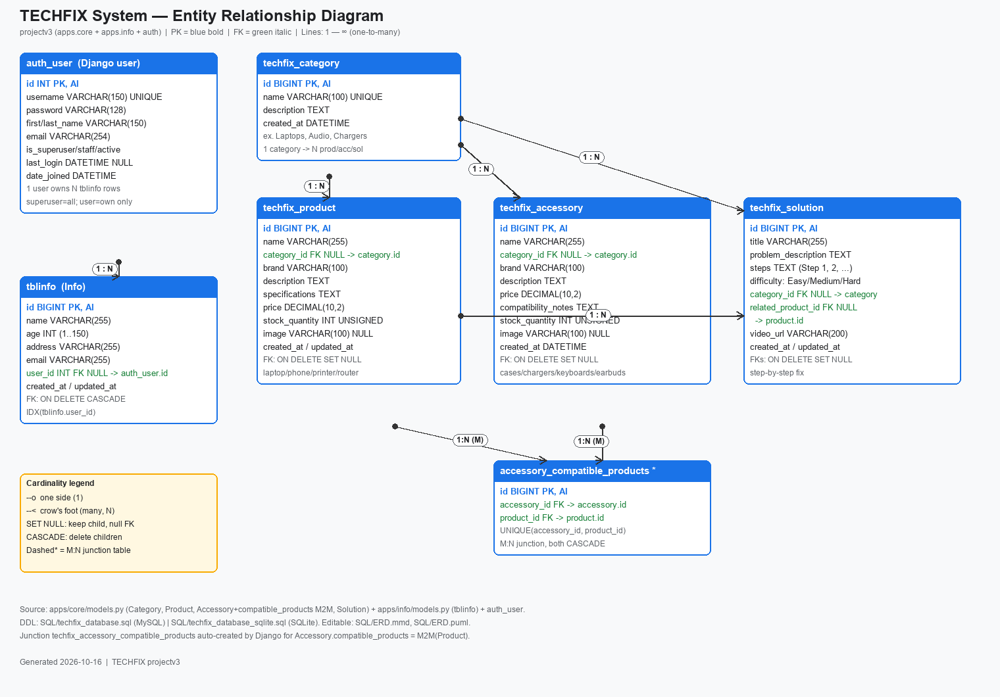
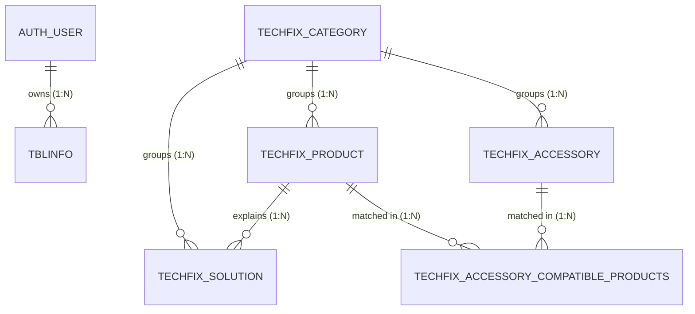

# TECHFIX System — Database & ERD

**Project:** `projectv3` (Django `apps.core` + `apps.info` + `apps.users`/auth)
**Source of truth:** `apps/core/models.py`, `apps/info/models.py`, `apps/scoping.py`
**Generated:** 2026-10-16

## Files in this folder

| File | Purpose |
|---|---|
| `techfix_database.sql` | Full database for **MySQL / MariaDB** (`CREATE DATABASE techfix_db` + 7 tables + PK/FK/indexes/checks). Import with phpMyAdmin or `mysql < techfix_database.sql`. |
| `techfix_database_sqlite.sql` | Same schema for **SQLite** (what the project runs on by default). Apply with `sqlite3 techfix.db < techfix_database_sqlite.sql`. |
| `ERD.mmd` | Editable ERD source (Mermaid `erDiagram`). Paste into https://mermaid.live or any Mermaid viewer. |
| `ERD.puml` | Editable ERD source (PlantUML). Open with a PlantUML plugin or http://www.plantuml.com/plantuml/uml. |
| `ERD.svg` | Vector diagram (opens in any browser, scales for reports). |
| `ERD.png` | Raster diagram (for Word / PPT / PDF submissions). |
| `ERD.md` | This file — data dictionary + relationships. |

## ERD (preview)

> If the image does not preview in your editor, open `ERD.png` or `ERD.svg` directly.
> The editable definitions are `ERD.mmd` (Mermaid) and `ERD.puml` (PlantUML).

## Entities (data dictionary)

### 1. `auth_user` — Django default user (used by `apps.users`)
| Column | Type | Key | Notes |
|---|---|---|---|
| id | INT AI | PK | |
| username | VARCHAR(150) | UNIQUE | login name |
| password | VARCHAR(128) | | hashed |
| first_name / last_name | VARCHAR(150) | | |
| email | VARCHAR(254) | | |
| is_superuser / is_staff / is_active | TINYINT(1) | | superuser sees all `tblinfo`; others see own only (`apps/scoping.py`) |
| last_login | DATETIME NULL | | |
| date_joined | DATETIME | | |

### 2. `techfix_category` — grouping (ex. Laptops, Audio, Chargers)
| Column | Type | Key | Notes |
|---|---|---|---|
| id | BIGINT AI | PK | table `techfix_category` |
| name | VARCHAR(100) | UNIQUE | |
| description | TEXT | | |
| created_at | DATETIME | | auto_now_add |

### 3. `techfix_product` — main tech devices (laptop, phone, printer, router)
| Column | Type | Key | Notes |
|---|---|---|---|
| id | BIGINT AI | PK | table `techfix_product` |
| name | VARCHAR(255) | IDX | |
| category_id | BIGINT NULL | FK → category.id | `SET NULL`, `related_name='products'` |
| brand | VARCHAR(100) | | |
| description | TEXT | | |
| specifications | TEXT | | RAM, CPU, Storage, etc. |
| price | DECIMAL(10,2) | | default 0 |
| stock_quantity | INT UNSIGNED | | default 0 |
| image | VARCHAR(100) NULL | | `upload_to='products/'` |
| created_at / updated_at | DATETIME | | |

### 4. `techfix_accessory` — add-ons (cases, chargers, keyboards, earbuds, cables)
| Column | Type | Key | Notes |
|---|---|---|---|
| id | BIGINT AI | PK | table `techfix_accessory` |
| name | VARCHAR(255) | IDX | |
| category_id | BIGINT NULL | FK → category.id | `SET NULL`, `related_name='accessories'` |
| brand | VARCHAR(100) | | |
| description | TEXT | | |
| price | DECIMAL(10,2) | | |
| compatibility_notes | TEXT | | ex. Compatible with USB-C laptops |
| stock_quantity | INT UNSIGNED | | |
| image | VARCHAR(100) NULL | | `upload_to='accessories/'` |
| created_at | DATETIME | | |

### 5. `techfix_accessory_compatible_products` — M:N junction (auto-created by Django)
`Accessory.compatible_products = ManyToManyField(Product, related_name='compatible_accessories')`
| Column | Type | Key | Notes |
|---|---|---|---|
| id | BIGINT AI | PK | |
| accessory_id | BIGINT | FK → accessory.id, `CASCADE` | part of `UNIQUE(accessory_id, product_id)` |
| product_id | BIGINT | FK → product.id, `CASCADE` | part of `UNIQUE(accessory_id, product_id)` |

### 6. `techfix_solution` — step-by-step fix for a common tech problem
| Column | Type | Key | Notes |
|---|---|---|---|
| id | BIGINT AI | PK | table `techfix_solution` |
| title | VARCHAR(255) | | |
| problem_description | TEXT | | symptoms / common issue |
| steps | TEXT | | Step 1, Step 2, … |
| difficulty_level | VARCHAR(10) | IDX | `Easy` / `Medium` / `Hard` (CHECK) |
| category_id | BIGINT NULL | FK → category.id | `SET NULL` |
| related_product_id | BIGINT NULL | FK → product.id | `SET NULL`, `related_name='solutions'` |
| video_url | VARCHAR(200) | | blank allowed |
| created_at / updated_at | DATETIME | | |

### 7. `tblinfo` — `apps.info.Info` (name/age/address/email, privately owned)
| Column | Type | Key | Notes |
|---|---|---|---|
| id | BIGINT AI | PK | `db_table='tblinfo'`, ordering by name |
| name | VARCHAR(255) | IDX | |
| age | INT (1–150) | | CHECK 1..150 |
| address | VARCHAR(255) | | |
| email | VARCHAR(255) | | blank allowed |
| user_id | INT NULL | FK → auth_user.id | `CASCADE`, `related_name='infos'` |
| created_at / updated_at | DATETIME | | |

## Relationships (crow's foot: 1 ──∞)

| # | Parent (1) | Child (N) | FK | On delete | Meaning |
|---|---|---|---|---|---|
| R1 | `auth_user` | `tblinfo` | `tblinfo.user_id` | CASCADE | 1 user owns N info rows |
| R2 | `techfix_category` | `techfix_product` | `product.category_id` | SET NULL | 1 category groups N products |
| R3 | `techfix_category` | `techfix_accessory` | `accessory.category_id` | SET NULL | 1 category groups N accessories |
| R4 | `techfix_category` | `techfix_solution` | `solution.category_id` | SET NULL | 1 category groups N solutions |
| R5 | `techfix_product` | `techfix_solution` | `solution.related_product_id` | SET NULL | 1 product explained by N solutions |
| R6/R7 | `techfix_product` ↔ `techfix_accessory` | junction | `accessory_id`, `product_id` | CASCADE/CASCADE | M:N — accessory works with many products and vice versa |

## How to use

**MySQL / phpMyAdmin (database `bsitcrud` or `techfix_db`):**
1. Open phpMyAdmin → Import → choose `techfix_database.sql` → Go.
2. Or CLI: `mysql -u root < SQL/techfix_database.sql`.

**SQLite (project default):**
`sqlite3 db.sqlite3 < SQL/techfix_database_sqlite.sql`
(or just run `python manage.py migrate` — Django creates the identical tables).

**ERD for documentation:**
- Word/PPT/PDF → insert `ERD.png`.
- Report appendix / GitHub → embed `ERD.svg` or the Mermaid block above.
- Editing → modify `ERD.mmd` / `ERD.puml` and re-export.

## Notes / assumptions
- Only the **current** system is modeled (core + info + auth_user). Stale tables still present in the old `db.sqlite3`/`bsitcrud.sql` dump (`catalog_*`, `tblcourse`, `tblstudents`, `tblattendance`, `tblquiz*`, etc.) are legacy and **not** part of this ERD, since they have no models in `projectv3/apps/`.
- `apps.users` has no custom model (`models.py` is empty), so the standard `auth_user` table is used.
- Cardinalities and `ON DELETE` rules are taken directly from the `on_delete=` arguments in `apps/core/models.py` and `apps/info/models.py`.
